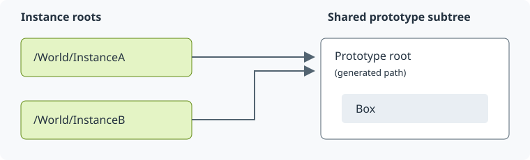

.. SPDX-FileCopyrightText: Copyright (c) 2026 NVIDIA CORPORATION & AFFILIATES. All rights reserved.
.. SPDX-License-Identifier: LicenseRef-NvidiaProprietary
..
.. NVIDIA CORPORATION, its affiliates and licensors retain all intellectual
.. property and proprietary rights in and to this material, related
.. documentation and any modifications thereto. Any use, reproduction,
.. disclosure or distribution of this material and related documentation
.. without an express license agreement from NVIDIA CORPORATION or
.. its affiliates is strictly prohibited.

Instancing Queries
==================

USD scene-graph instancing lets multiple prims share the same child subtree.
Mark prims that bring in content through references or other composition arcs
with ``instanceable = true``. USD automatically groups compatible prims and
creates a shared **prototype** for each group; you do not create the prototype
yourself. For example, references to the same asset with different variant
selections can produce separate prototypes.

An **instance root** is the prim where an instance of the shared subtree
appears. A **prototype root** is the root of that shared subtree. Use
``ovstage.instancing`` to find these prims after :term:`population`.
For example, two instanceable references can share one prototype:

   Discover generated prototype paths through the API; do not hard-code them.

In every population domain, ordinary instance roots use ``XformInstance`` or
``ScopeInstance`` and the synthetic instance tags. ``PHYSICS`` and selectors
also preserve the authored type in ``usd-metadata:typeName``. Instanceable prims
authored beneath a ``PointInstancer`` are the exception: they keep authored
metadata but still link their prototypes and appear in these queries.

With ``RENDERING``, geometry within an instance can also use ``MeshInstance`` or
``CubeInstance``. These are populated representations, not types you author in
USD. See :ref:`Population — instance types <population-instance-types>` for the
metadata rules and rendering-only exceptions.

The instancing queries return the instance and prototype **roots**. A generated
``MeshInstance`` or ``CubeInstance`` beneath an instance root is part of that
instance; its runtime type alone does not make it another instance root.

These queries describe scene-graph instances. They do not enumerate individual
``PointInstancer`` elements. A subtree made with :doc:`cloning` is a copy;
cloning alone does not make it an instance of a shared prototype.

.. note::

   These APIs are provisional and may change.

Before Querying
---------------

Queries use the current :term:`populated <Population>` content of the runtime
stage. They do not inspect the source USD stage. The :doc:`population` domain
and selectors determine which content is available.

The functions are synchronous and have no :term:`ordinal` argument. Wait for
population or an update to finish, then advance the :term:`watermark` before
querying. Call again after later updates to get fresh results; a returned list
does not update itself.

The runnable examples use two independent stages: ``queries.usda`` for the
simple case below, and ``nested.usda`` for nested instances. Both follow the
same sequence. Here is the population step for the nested scene:
``SCENE`` locates the Python example's main scene file.

.. tab-set::

   .. tab-item:: Python

      .. filtered-literalinclude:: ../../examples/python/queries/main.py
         :language: python
         :snippets: instancing-imports, instancing-timing

   .. tab-item:: C

      ``nestedFile`` locates the nested scene. ``floor1`` has ordinal 1 and
      scope ``OVSTAGE_SCOPE_ALL``.

      ``waitPop()`` and ``waitOp()`` wait, check completion, and release the
      operation. Later snippets use ``check()`` and ``checkOvx()`` to check
      statuses, and ``pathListHandles()`` and ``resolvePath()`` to read paths.
      These helpers are defined in the runnable C example.

      .. filtered-literalinclude:: ../../examples/c/queries/main.cpp
         :language: cpp
         :snippets: instancing-timing-c

Finding Instances and Prototypes
--------------------------------

The Python functions accept and return path strings:

.. list-table::
   :header-rows: 1

   * - Function in ``ovstage.instancing``
     - Result
   * - :func:`get_prototype_roots(stage) <ovstage.instancing.get_prototype_roots>`
     - All prototype-root paths.
   * - :func:`get_instance_roots(stage, prototype_root) <ovstage.instancing.get_instance_roots>`
     - Instance-root paths that reference that prototype.
   * - :func:`get_prototype_root(stage, instance_root) <ovstage.instancing.get_prototype_root>`
     - The prototype-root path referenced by that instance.

Here, ``InstanceA`` and ``InstanceB`` are instanceable references to the same
subtree:

.. code-block:: usda

   #usda 1.0
   def Xform "World"
   {
       def Xform "Prototype"
       {
           def Cube "Box" {}
       }
       def Xform "InstanceA" (
           instanceable = true
           prepend references = </World/Prototype>
       ) {}
       def Xform "InstanceB" (
           instanceable = true
           prepend references = </World/Prototype>
       ) {}
   }

These queries discover the generated prototype and list its instances.
Sorting makes the printed output stable.

.. tab-set::

   .. tab-item:: Python

      .. filtered-literalinclude:: ../../examples/python/queries/main.py
         :language: python
         :snippets: instancing-imports, instancing-queries

   .. tab-item:: C

      .. filtered-literalinclude:: ../../examples/c/queries/main.cpp
         :language: cpp
         :snippets: instancing-queries-c

Prototype-root paths are opaque: every population domain names a given prototype the
same way, and the name is not USD's prototype path. Resolve prototype roots through
these queries; do not construct or compare them by spelling.

Nested Instances
----------------

A shared subtree can itself contain an instance. :func:`get_instance_roots() <ovstage.instancing.get_instance_roots>`
returns its paths through the outer instances, and :func:`get_prototype_root() <ovstage.instancing.get_prototype_root>`
accepts those paths too.

Here, ``OuterA`` instances a subtree that contains another instance:

.. literalinclude:: ../../examples/python/queries/nested.usda
   :language: usda

These queries find the leaf instance under both ``OuterSource`` and
``OuterA``, then verify that both paths share the same prototype.

.. tab-set::

   .. tab-item:: Python

      .. filtered-literalinclude:: ../../examples/python/queries/main.py
         :language: python
         :snippets: instancing-imports, instancing-nested

   .. tab-item:: C

      .. filtered-literalinclude:: ../../examples/c/queries/main.cpp
         :language: cpp
         :snippets: instancing-nested-c

Empty Results and Missing Instances
-----------------------------------

:func:`get_prototype_roots() <ovstage.instancing.get_prototype_roots>` returns an empty list when the stage has no
scene-graph prototypes. :func:`get_instance_roots() <ovstage.instancing.get_instance_roots>` returns an empty list when no
instance roots reference the supplied prototype.

:func:`get_prototype_root() <ovstage.instancing.get_prototype_root>` raises ``OvstageError`` with code
``ErrorCode.NOT_FOUND`` if the path is not an instance root, including when the
prim does not exist. It is not a general prim-existence check; see
:doc:`queries` for that.

Here, ``/World/LeafSource`` is an ordinary source prim. Referencing it from
instances does not make the source prim itself an instance root:

.. tab-set::

   .. tab-item:: Python

      .. filtered-literalinclude:: ../../examples/python/queries/main.py
         :language: python
         :snippets: instancing-imports, instancing-not-found

   .. tab-item:: C

      .. filtered-literalinclude:: ../../examples/c/queries/main.cpp
         :language: cpp
         :snippets: instancing-not-found-c

C Result Ownership
------------------

The functions in ``ovstage_instancing.h`` have the same names with the
``ovstage_instancing_`` prefix. They use path identifiers rather than strings.

:c:func:`ovstage_instancing_get_prototype_roots() <ovstage_instancing_get_prototype_roots>` and
:c:func:`ovstage_instancing_get_instance_roots() <ovstage_instancing_get_instance_roots>` return caller-owned
``ovx_primpath_list_t`` references. Release them through the
:doc:`path_dictionary`. :c:func:`ovstage_instancing_get_prototype_root() <ovstage_instancing_get_prototype_root>` returns one
``ovx_primpath_t`` that lasts for the dictionary's lifetime and needs no release.
The Python wrappers convert and release native lists before returning.

Further Reading
---------------

* `OpenUSD scene-graph instancing <https://openusd.org/dev/api/_usd__page__scenegraph_instancing.html>`_ — how USD creates and shares prototypes.
* :doc:`population` — load USD content before querying instances.
* :doc:`path_dictionary` — resolve identifiers and release path lists.
* :doc:`/c_api/index` and :doc:`/python_api/index` — API signatures.
